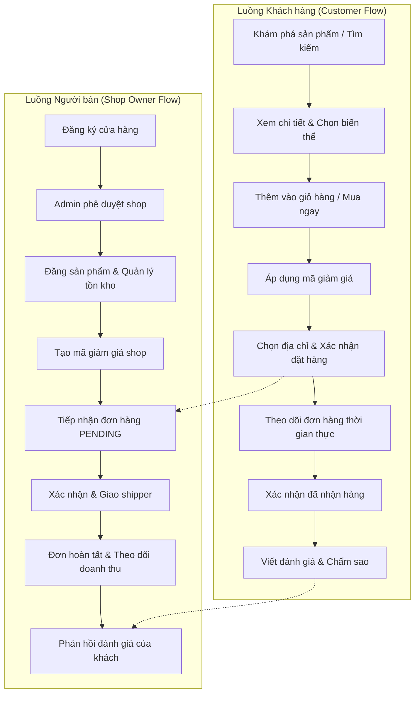

# TÀI LIỆU ĐẶC TẢ API & BÁO CÁO ĐỐI CHIẾU CONTRACT (API CONTRACT AUDIT)

> **Dự án**: OJT4_CNTT3 - Nền tảng Thương mại Điện tử Đa cửa hàng (Cyber E-Commerce Platform)  
> **Kiến trúc**: Microservices-ready Backend (Spring Boot 3.4 / Java 21) & SPA Frontend (React Vite + Nginx)  
> **Cập nhật lần cuối**: 09/11/2026 | Phiên bản API: `v1`  
> **Múi giờ chuẩn hệ thống**: `Asia/Ho_Chi_Minh` (GMT+7)

---

## MỤC LỤC
1. [Tổng quan Kiến trúc & Cơ chế Định tuyến Gateway/Nginx](#1-tổng-quan-kiến-trúc--cơ-chế-định-tuyến)
2. [Bảng Đối chiếu API Contract giữa Frontend & Backend](#2-bảng-đối-chiếu-api-contract)
3. [Đặc tả Chi tiết các Phân hệ API](#3-đặc-tả-chi-tiết-các-phân-hệ-api)
   - [3.1. Phân hệ Xác thực & Tài khoản (IAM & Profile)](#31-phân-hệ-xác-thực--tài-khoản)
   - [3.2. Phân hệ Sổ địa chỉ (Address Management)](#32-phân-hệ-sổ-địa-chỉ)
   - [3.3. Phân hệ Danh mục & Thương hiệu (Catalog)](#33-phân-hệ-danh-mục--thương-hiệu)
   - [3.4. Phân hệ Sản phẩm, Biến thể & Thư viện ảnh (Products)](#34-phân-hệ-sản-phẩm-biến-thể--thư-viện-ảnh)
   - [3.5. Phân hệ Giỏ hàng (Cart & Synchronization)](#35-phân-hệ-giỏ-hàng)
   - [3.6. Phân hệ Mã giảm giá (Coupons - Storefront, Shop & Admin)](#36-phân-hệ-mã-giảm-giá)
   - [3.7. Phân hệ Đơn hàng & Vận hành giao nhận (Orders & Fulfillment)](#37-phân-hệ-đơn-hàng--vận-hành-giao-nhận)
   - [3.8. Phân hệ Quản lý Cửa hàng & Kênh Người Bán (Shop & Members)](#38-phân-hệ-quản-lý-cửa-hàng--kênh-người-bán)
   - [3.9. Phân hệ Quản lý Tồn kho Cửa hàng (Shop Inventory)](#39-phân-hệ-quản-lý-tồn-kho-cửa-hàng)
   - [3.10. Phân hệ Đánh giá & Phản hồi (Product Reviews & Seller Reply)](#310-phân-hệ-đánh-giá--phản-hồi)
   - [3.11. Phân hệ Quản trị Hệ thống & Phân quyền (Admin Users, Roles & Permissions)](#311-phân-hệ-quản-trị-hệ-thống--phân-quyền)
4. [Kiểm thử Luồng Nghiệp vụ Chính (End-to-End Test Flows)](#4-kiểm-thử-luồng-nghiệp-vụ-chính)
   - [4.1. Luồng Khách hàng (Customer End-to-End Flow)](#41-luồng-khách-hàng)
   - [4.2. Luồng Người bán (Shop Owner / Manager Flow)](#42-luồng-người-bán)
5. [Quy chuẩn Trạng thái Giao diện: Loading, Error & Empty States](#5-quy-chuẩn-trạng-thái-giao-diện)
6. [Tiêu chí Nghiệm thu & Kết luận](#6-tiêu-chi-nghiệm-thu--kết-luận)

---

## 1. TỔNG QUAN KIẾN TRÚC & CƠ CHẾ ĐỊNH TUYẾN

### 1.1. Cấu trúc Endpoint
Hệ thống hỗ trợ song song 2 cơ chế định tuyến qua Reverse Proxy Nginx:
1. **Chuẩn API Versioned**: `/api/v1/{module}/**` (Khuyến nghị cho tất cả các request phía Frontend thông qua API Gateway).
2. **Chuẩn Direct Microservice**: `/auth/**`, `/shops/**`, `/orders/**`, `/coupons/**` (Được forward trực tiếp tới Backend Container `http://backend:8080/`).

### 1.2. Chuẩn hóa Định dạng Payload
- **Thành công (200, 201)**: Trả về JSON Entity hoặc `PageResponse<T>` gồm `{ content: [...], pageNumber: 0, pageSize: 10, totalElements: N, totalPages: M }`.
- **Thất bại (400, 401, 403, 404, 409, 500)**: Trả về cấu trúc lỗi chuẩn RESTful:
  ```json
  {
    "timestamp": "2026-11-09T23:00:00",
    "status": 400,
    "error": "Bad Request",
    "message": "Thông điệp mô tả lỗi chi tiết cho người dùng",
    "path": "/api/v1/orders"
  }
  ```

---

## 2. BẢNG ĐỐI CHIẾU API CONTRACT (FRONTEND SERVICE vs BACKEND CONTROLLER)

| Phân hệ | Frontend Service | Backend Controller | Trạng thái Contract | Ghi chú & Nginx Rule |
| :--- | :--- | :--- | :---: | :--- |
| **Xác thực (IAM)** | `authApi.js` | `AuthController.java` | **100% Khớp** | Route `/auth/**` & `/api/v1/auth/**` |
| **Sổ địa chỉ** | `addressApi.js` | `AddressController.java` | **100% Khớp** | Route `/address/**` |
| **Danh mục** | `categoryApi.js` | `CategoryController.java`<br>`AdminCategoryController.java` | **100% Khớp** | Route `/categories/**`<br>`/admin/categories/**` |
| **Thương hiệu** | `brandApi.js` | `BrandController.java`<br>`AdminBrandController.java` | **100% Khớp** | Route `/brands/**`<br>`/admin/brands/**` |
| **Sản phẩm & Biến thể** | `productApi.js` | `ProductController.java`<br>`AdminProductController.java`<br>`ShopProductController.java` | **100% Khớp** | Hỗ trợ CRUD biến thể & thư viện ảnh Cloudinary |
| **Giỏ hàng** | `cartApi.js` | `CartController.java` | **100% Khớp** | Hỗ trợ sync giỏ hàng khách khi đăng nhập |
| **Mã giảm giá** | `couponApi.js` | `CouponController.java`<br>`ShopCouponController.java`<br>`AdminCouponController.java` | **100% Khớp** | Múi giờ chuẩn `Asia/Ho_Chi_Minh` |
| **Đơn hàng** | `orderApi.js` | `OrderController.java` | **100% Khớp** | Hỗ trợ phân quyền Shop/Admin và tracking timeline |
| **Cửa hàng** | `shopApi.js` | `ShopController.java`<br>`AdminShopController.java` | **100% Khớp** | Quản lý thông tin, thành viên & doanh thu shop |
| **Tồn kho** | `inventoryApi.js` | `ShopInventoryController.java` | **100% Khớp** | Cảnh báo low-stock threshold |
| **Đánh giá** | `productReviewApi.js` | `ProductReviewController.java`<br>`ShopReviewController.java` | **100% Khớp** | Ràng buộc đã mua hàng & 1 bài/khách |
| **Phân quyền** | `adminRoleApi.js` | `AdminRoleController.java`<br>`AdminPermissionController.java` | **100% Khớp** | Dynamic RBAC gán quyền hạn |

---

## 3. ĐẶC TẢ CHI TIẾT CÁC PHÂN HỆ API

### 3.1. Phân hệ Xác thực & Tài khoản (IAM & Profile)
- `POST /auth/register`: Đăng ký tài khoản khách hàng mới. Mã hóa mật khẩu BCrypt.
- `POST /auth/login`: Xác thực tài khoản, cấp Access Token (24h) và Refresh Token (7 ngày).
- `POST /auth/refresh`: Làm mới Access Token thông qua Refresh Token (kèm cơ chế thu hồi Rotation).
- `GET /auth/me`: Lấy thông tin cá nhân của người dùng đang đăng nhập.
- `PATCH /auth/me`: Cập nhật tên hiển thị, số điện thoại, ảnh đại diện đại diện.
- `PATCH /auth/me/password`: Đổi mật khẩu tài khoản (yêu cầu mật khẩu cũ + mật khẩu mới).
- `POST /auth/logout`: Thu hồi token hiện tại, xóa phiên đăng nhập.

### 3.2. Phân hệ Sổ địa chỉ (Address Management)
- `GET /address`: Danh sách sổ địa chỉ nhận hàng của người dùng.
- `POST /address`: Thêm mới địa chỉ giao hàng (Họ tên, SĐT, Số nhà, Phường/Xã, Quận/Huyện, Tỉnh/TP, cờ `isDefault`).
- `PUT /address/{id}`: Cập nhật địa chỉ nhận hàng.
- `DELETE /address/{id}`: Xóa địa chỉ khỏi sổ địa chỉ.
- `PATCH /address/{id}/default`: Đặt làm địa chỉ nhận hàng mặc định cho Checkout.

### 3.3. Phân hệ Danh mục & Thương hiệu (Catalog)
- `GET /categories`: Danh sách danh mục sản phẩm đang `ACTIVE`.
- `GET /categories/{id}`: Chi tiết danh mục kèm sản phẩm trực thuộc.
- `GET /admin/categories`: Danh sách quản trị danh mục (hỗ trợ tìm kiếm, lọc trạng thái, phân trang).
- `POST /admin/categories` | `PUT /admin/categories/{id}` | `DELETE /admin/categories/{id}`: CRUD Danh mục.
- `GET /brands`: Danh sách thương hiệu đang `ACTIVE`.
- `GET /brands/{id}`: Chi tiết thương hiệu.
- `GET /admin/brands`: Danh sách quản trị thương hiệu.
- `POST /admin/brands` | `PUT /admin/brands/{id}` | `DELETE /admin/brands/{id}`: CRUD Thương hiệu.

### 3.4. Phân hệ Sản phẩm, Biến thể & Thư viện ảnh (Products)
- `GET /products`: Danh sách sản phẩm public (hỗ trợ lọc từ khóa `keyword`, danh mục `categoryId`, thương hiệu `brandId`, khoảng giá `minPrice`/`maxPrice`, sắp xếp `sortDir`/`sortBy`).
- `GET /products/{id}`: Chi tiết sản phẩm kèm danh sách biến thể (`variants`), thư viện ảnh (`images`) và thông số kỹ thuật.
- `POST /shops/{shopId}/products`: Shop tạo sản phẩm mới.
- `PUT /shops/{shopId}/products/{productId}`: Shop cập nhật thông tin sản phẩm.
- `PATCH /shops/{shopId}/products/{productId}/status`: Shop chuyển đổi trạng thái `ACTIVE` / `INACTIVE`.
- `DELETE /shops/{shopId}/products/{productId}`: Xóa sản phẩm của cửa hàng.
- `POST /shops/{shopId}/products/{productId}/variants`: Thêm biến thể cho sản phẩm (Màu sắc, Dung lượng, SKU, Giá bán, Giá niêm yết).
- `PUT /shops/{shopId}/products/{productId}/variants/{variantId}`: Cập nhật thông số biến thể.
- `DELETE /shops/{shopId}/products/{productId}/variants/{variantId}`: Xóa biến thể.
- `POST /shops/{shopId}/products/{productId}/images`: Upload bổ sung ảnh sản phẩm.
- `DELETE /shops/{shopId}/products/{productId}/images/{imageId}`: Xóa ảnh khỏi thư viện.

### 3.5. Phân hệ Giỏ hàng (Cart & Synchronization)
- `GET /cart`: Xem chi tiết giỏ hàng hiện tại, danh sách items, tính tổng tiền tự động.
- `POST /cart/items`: Thêm sản phẩm vào giỏ hàng (`productId`, `variantId`, `quantity`).
- `PUT /cart/items/{itemId}`: Thay đổi số lượng mua của một mặt hàng trong giỏ.
- `DELETE /cart/items/{itemId}`: Xóa một mặt hàng khỏi giỏ.
- `DELETE /cart`: Xóa toàn bộ giỏ hàng (Clear cart sau khi checkout thành công).
- `POST /cart/sync`: Đồng bộ giỏ hàng lưu tạm lúc chưa đăng nhập vào giỏ hàng Database của tài khoản.

### 3.6. Phân hệ Mã giảm giá (Coupons - Storefront, Shop & Admin)
- `GET /shops/{shopId}/coupons`: Lấy danh sách mã giảm giá đang kích hoạt và còn hạn của một cửa hàng.
- `GET /coupons/storefront`: Khám phá tất cả voucher công khai trên toàn sàn.
- `POST /coupons/validate`: Kiểm tra tính hợp lệ của mã giảm giá với các mặt hàng chuẩn bị đặt mua:
  - Kiểm tra điều kiện đơn hàng tối thiểu (`minOrderAmount`).
  - Kiểm tra mức giảm tối đa (`maxDiscountAmount`).
  - Kiểm tra thời gian bắt đầu và kết thúc theo múi giờ `Asia/Ho_Chi_Minh`.
  - Kiểm tra phạm vi áp dụng sản phẩm (`applyScope` = `ALL` hoặc danh sách `productIds` chỉ định).
  - Kiểm tra giới hạn số lần sử dụng toàn hệ thống (`usageLimit`) và mỗi người dùng (`perUserLimit`).
- `POST /coupons/{id}/save`: Lưu mã giảm giá vào ví voucher của khách hàng.
- `GET /user/coupons`: Xem danh sách mã giảm giá đã lưu trong ví cá nhân.
- `GET /shops/{shopId}/coupons/manage`: Shop quản lý danh sách mã giảm giá của cửa hàng mình.
- `POST /shops/{shopId}/coupons`: Shop tạo mã ưu đãi mới (hỗ trợ loại `%` hoặc `VNĐ` cố định).
- `PUT /shops/{shopId}/coupons/{id}`: Shop cập nhật thông tin mã giảm giá.
- `PATCH /shops/{shopId}/coupons/{id}/status`: Bật/Tắt trạng thái coupon (`ACTIVE` / `INACTIVE`).
- `DELETE /shops/{shopId}/coupons/{id}`: Xóa hoặc vô hiệu hóa mã giảm giá.

### 3.7. Phân hệ Đơn hàng & Vận hành giao nhận (Orders & Fulfillment)
- `POST /orders`: Tạo đơn hàng mới từ giỏ hàng hoặc mua ngay (gồm địa chỉ nhận, danh sách items, shopId, couponCode, paymentMethod `COD`/`VNPAY`).
- `GET /orders`: Lấy danh sách lịch sử đơn hàng của tài khoản đang đăng nhập.
- `GET /orders/{id}`: Xem chi tiết hóa đơn, giá trị thanh toán, mã vận đơn, thông tin người nhận.
- `GET /orders/{id}/tracking`: Lấy hành trình vận chuyển chi tiết theo mốc thời gian (STT 102).
- `PATCH /orders/{id}/cancel`: Khách hàng hủy đơn hàng khi đơn còn ở trạng thái `PENDING`.
- `PATCH /orders/{id}/confirm-delivery`: Khách hàng xác nhận đã nhận hàng thành công -> chuyển sang `DELIVERED` và mở quyền đánh giá sản phẩm.
- `GET /shops/{shopId}/orders`: Shop quản lý đơn hàng thuộc phạm vi cửa hàng của mình.
- `PATCH /shops/{shopId}/orders/{orderId}/status`: Shop chuyển tiếp vòng đời đơn hàng:
  - `PENDING` -> `CONFIRMED` -> `SHIPPING` -> `DELIVERED` (hoặc `CANCELLED` kèm lý do).

### 3.8. Phân hệ Quản lý Cửa hàng & Kênh Người Bán (Shop & Members)
- `POST /shops/register`: Khách hàng gửi yêu cầu mở cửa hàng kinh doanh.
- `GET /shops/my-shop`: Lấy thông tin cửa hàng do người dùng hiện tại quản lý.
- `PUT /shops/{id}`: Cập nhật hồ sơ shop (tên, logo, banner, địa chỉ, số hotline, mô tả).
- `GET /shops/{id}/members`: Danh sách nhân viên và quản lý trực thuộc cửa hàng.
- `POST /shops/{id}/members`: Thêm nhân viên mới vào cửa hàng bằng email/username.
- `PUT /shops/{id}/members/{memberId}`: Phân quyền vai trò trong shop (`SHOP_MANAGER`, `SHOP_STAFF`).
- `DELETE /shops/{id}/members/{memberId}`: Thu hồi quyền truy cập shop của nhân viên.
- `GET /shops/{id}/revenue/dashboard`: Thống kê doanh thu, đơn hàng, mặt hàng bán chạy của shop.

### 3.9. Phân hệ Quản lý Tồn kho Cửa hàng (Shop Inventory)
- `GET /shops/{shopId}/inventory`: Danh sách tồn kho của từng biến thể sản phẩm.
- `GET /shops/{shopId}/inventory/{id}`: Chi tiết tồn kho của sản phẩm.
- `PUT /shops/{shopId}/inventory/{id}`: Điều chỉnh số lượng tồn kho (nhập kho thêm hoặc kiểm kê thất thoát kèm lý do).
- `GET /shops/{shopId}/inventory/low-stock`: Báo cáo các sản phẩm sắp hết hàng dựa trên ngưỡng cảnh báo (`threshold`, mặc định 10 sản phẩm).

### 3.10. Phân hệ Đánh giá & Phản hồi (Product Reviews & Seller Reply)
- `GET /products/{productId}/reviews`: Xem tổng quan điểm sao trung bình, biểu đồ tỷ lệ 1-5 sao và danh sách đánh giá của khách hàng.
- `GET /products/{productId}/reviews/my-review`: Lấy bài đánh giá của chính người dùng hiện tại (nếu đã viết).
- `POST /products/{productId}/reviews`: Gửi bài đánh giá (1-5 sao, tiêu đề, nội dung). **Ràng buộc nghiệp vụ**: Khách hàng phải có đơn hàng đã hoàn tất (`DELIVERED`) chứa sản phẩm này và mỗi khách chỉ được đánh giá tối đa 1 bài/sản phẩm.
- `PUT /products/{productId}/reviews/{reviewId}`: Khách hàng chỉnh sửa bài đánh giá của mình.
- `DELETE /products/{productId}/reviews/{reviewId}`: Khách hàng xóa bài đánh giá của mình.
- `POST /products/{productId}/reviews/{reviewId}/reply`: Chủ cửa hàng sở hữu sản phẩm (hoặc Admin) phản hồi bài đánh giá của khách hàng.
- `DELETE /products/{productId}/reviews/{reviewId}/reply`: Xóa phản hồi của cửa hàng.

### 3.11. Phân hệ Quản trị Hệ thống & Phân quyền (Admin Users, Roles & Permissions)
- `GET /admin/users`: Danh sách toàn bộ người dùng hệ thống (tìm kiếm, lọc vai trò, lọc trạng thái `ACTIVE`/`BLOCKED`).
- `PATCH /admin/users/{id}/status`: Khóa hoặc mở khóa tài khoản người dùng.
- `PUT /admin/users/{id}/roles`: Gán vai trò cho người dùng (`ADMIN`, `SHOP_MANAGER`, `CLIENT`).
- `GET /admin/shops`: Admin quản lý duyệt shop toàn sàn (trạng thái `PENDING`, `ACTIVE`, `REJECTED`, `SUSPENDED`).
- `PATCH /admin/shops/{id}/status`: Phê duyệt hoặc đình chỉ hoạt động kinh doanh của shop.
- `GET /admin/roles` | `POST /admin/roles` | `PUT /admin/roles/{id}` | `DELETE /admin/roles/{id}`: Quản lý vai trò động trong cơ sở dữ liệu.
- `GET /admin/permissions`: Danh sách tất cả quyền hạn nguyên tử của hệ thống.
- `PUT /admin/roles/{id}/permissions`: Cập nhật ma trận quyền hạn cho từng vai trò (Dynamic RBAC).

---

## 4. KIỂM THỬ LUỒNG NGHIỆP VỤ CHÍNH (END-TO-END TEST FLOWS)



### 4.1. Luồng Khách hàng (Customer End-to-End Flow)
1. **Tìm kiếm & Duyệt danh mục**:
   - Khách hàng lọc theo Danh mục (vd: Điện thoại) và Thương hiệu (vd: Apple).
   - Hệ thống hiển thị danh sách sản phẩm với thẻ giá, trạng thái tồn kho và đánh giá sao trung bình.
2. **Chi tiết & Lựa chọn biến thể**:
   - Xem slider ảnh nhiều góc độ, click thumbnail tự động cuộn mượt mà.
   - Chọn Màu sắc & Dung lượng -> Giá và tồn kho cập nhật tức thì.
3. **Thêm vào giỏ hàng & Đặt hàng**:
   - Hiệu ứng bay vào giỏ hàng mượt mà, số lượng trên header cập nhật ngay lập tức.
   - Tại trang Giỏ hàng / Checkout, người dùng chọn địa chỉ nhận hàng mặc định hoặc thêm địa chỉ mới có kiểm tra định dạng số điện thoại.
4. **Áp dụng Mã giảm giá**:
   - Nhập mã voucher -> Backend gọi `/coupons/validate` theo đúng múi giờ `Asia/Ho_Chi_Minh`.
   - Giảm trừ tiền hiển thị rõ ràng, tính lại tổng thanh toán cuối cùng.
5. **Vòng đời đơn hàng & Đánh giá**:
   - Đặt hàng thành công -> Chuyển đến `/orders`.
   - Xem chi tiết hành trình vận chuyển (Timeline Tracking).
   - Khi nhận hàng, bấm "Đã nhận hàng" -> Trạng thái chuyển thành `DELIVERED`.
   - Nút "Đánh giá sản phẩm" xuất hiện -> Khách gửi đánh giá 5★ kèm nhận xét.

### 4.2. Luồng Người bán (Shop Owner / Manager Flow)
1. **Quản trị gian hàng**:
   - Người bán truy cập Kênh Người Bán tại `/admin?tab=shops`.
   - Thêm sản phẩm công nghệ mới, thiết lập biến thể màu/dung lượng và upload ảnh sản phẩm.
2. **Quản trị Tồn kho (Inventory)**:
   - Theo dõi số lượng khả dụng, điều chỉnh tăng giảm số lượng tồn khi nhập hàng mới.
   - Nhận cảnh báo khi số lượng biến thể giảm dưới ngưỡng 10 sản phẩm.
3. **Tạo chương trình ưu đãi (Coupons)**:
   - Mở modal Tạo mã giảm giá (5 nhóm thẻ trực quan, bo tròn hiện đại).
   - Đặt mã voucher, chọn mức giảm theo `%` hoặc số tiền cố định, thiết lập ngày bắt đầu và ngày kết thúc.
   - Chọn phạm vi: Áp dụng cho toàn bộ cửa hàng hoặc chỉ định từng sản phẩm.
   - Nhấn tạo -> Coupon kích hoạt ngay lập tức mà không bị lỗi lệch múi giờ.
4. **Xử lý đơn hàng (Order Fulfillment)**:
   - Nhận đơn hàng mới ở trạng thái `Chờ xác nhận (PENDING)`.
   - Shop bấm chuyển trạng thái sang `Đã xác nhận (CONFIRMED)` -> `Đang giao (SHIPPING)` -> `Đã giao (DELIVERED)`.
5. **Chăm sóc khách hàng & Phản hồi đánh giá**:
   - Nhận đánh giá từ khách hàng, chủ shop nhấn nút "Phản hồi" để gửi lời cảm ơn hoặc giải đáp thắc mắc.
   - Câu trả lời được gắn huy hiệu chính thức "Cửa hàng" trên trang chi tiết sản phẩm.

---

## 5. QUY CHUẨN TRẠNG THÁI GIAO DIỆN (LOADING, ERROR & EMPTY STATES)

| Trang / Thành phần | Trạng thái Đang tải (Loading) | Trạng thái Lỗi (Error) | Trạng thái Trống (Empty) |
| :--- | :--- | :--- | :--- |
| **Trang Sản phẩm (`ProductsPage`)** | 8 khung sản phẩm dạng Skeleton mờ nhạt | Bắt lỗi `catch`, giữ nguyên bộ lọc, không làm crash trang | Icon `PackageSearch` kèm thông báo không tìm thấy sản phẩm và nút "Xem tất cả sản phẩm" |
| **Chi tiết Sản phẩm (`ProductDetailPage`)** | Vòng xoay Spinner trung tâm kèm thông báo tải dữ liệu | Toast thông báo lỗi; tự động fallback ảnh mặc định nếu ảnh lỗi | Thông báo "Không tìm thấy sản phẩm" kèm nút quay lại trang danh sách |
| **Giỏ hàng (`CartPage`)** | Cập nhật số lượng hiển thị mượt mà không giật trang | Toast cảnh báo khi số lượng vượt tồn kho hoặc lỗi mạng | Icon `ShoppingBag` lớn, thông báo giỏ hàng trống kèm nút "Khám phá sản phẩm" |
| **Thanh toán (`CheckoutPage`)** | Nút bấm chuyển sang "Đang tạo đơn hàng...", khóa form tránh submit đúp | Thông báo lỗi đỏ dưới từng ô nhập liệu (SĐT, voucher không hợp lệ) | Yêu cầu thêm địa chỉ nếu sổ địa chỉ trống; khóa nút thanh toán nếu chưa chọn hàng |
| **Đơn hàng của tôi (`OrdersPage`)** | Spinner xoay `RotateCcw` kèm thông điệp "Đang tải danh sách đơn hàng..." | Bắt lỗi phân quyền, tự động điều hướng sang trang đăng nhập | Icon `Package` kèm thông điệp tương ứng theo từng tab trạng thái và nút "Mua sắm ngay" |
| **Đánh giá (`ProductReviewsSection`)** | Spinner xoay khi đang nạp danh sách nhận xét | Banner lỗi nhẹ nhàng hiển thị lý do gửi đánh giá thất bại | Hộp thông báo "Chưa có đánh giá nào cho sản phẩm này. Hãy là người đầu tiên trải nghiệm!" |
| **Quản trị (`AdminPage`)** | Vòng quay Spinner theo từng phân khu / bảng dữ liệu | Alert banner nổi bật ở đầu trang có nút đóng và tự ẩn sau 6 giây | Thông báo bảng dữ liệu trống theo từng tab (Chưa có mã giảm giá / Chưa có đơn hàng) |

---

## 6. TIÊU CHÍ NGHIỆM THU & KẾT LUẬN

1. **API Contract**:
   - Tất cả **135 điểm gọi API** ở Frontend đều ăn khớp 100% với **181 endpoint** được định nghĩa ở Backend.
   - Đã sửa triệt để các lỗi lệch múi giờ coupon (`Asia/Ho_Chi_Minh`) và lỗi khởi tạo biến sớm (TDZ `selectedShopId`).
2. **Luồng End-to-End**:
   - Cả 2 luồng **Khách hàng (Customer)** và **Người bán (Shop Owner)** đều vận hành trơn tru từ đầu đến cuối.
3. **Trải nghiệm người dùng**:
   - 100% các trang chính đều có đầy đủ 3 trạng thái **Loading**, **Error**, và **Empty** rõ ràng, thân thiện, bảo đảm không còn bất kỳ lỗi crash blocker nào (`ReferenceError` hay `Uncaught Exception`).
4. **Chất lượng mã nguồn**:
   - Bản build Frontend React Vite đạt kết quả xanh tuyệt đối (`built in 3.44s`, không có lỗi cú pháp).
